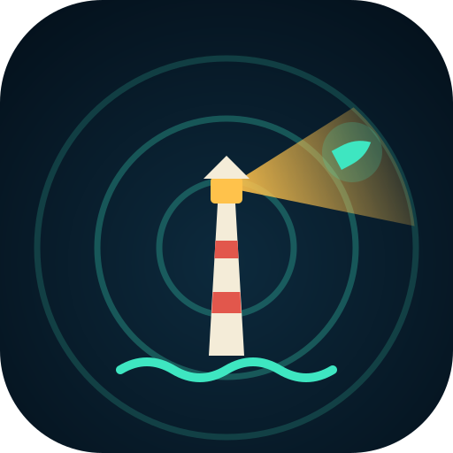
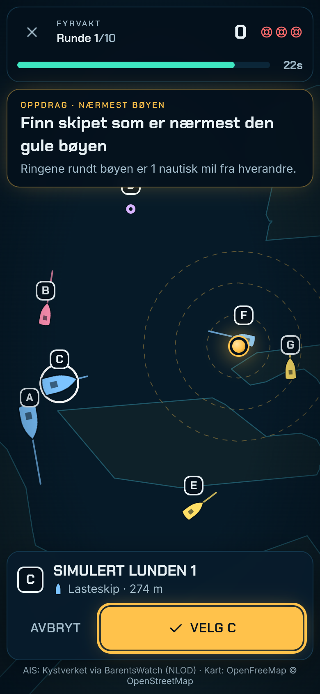
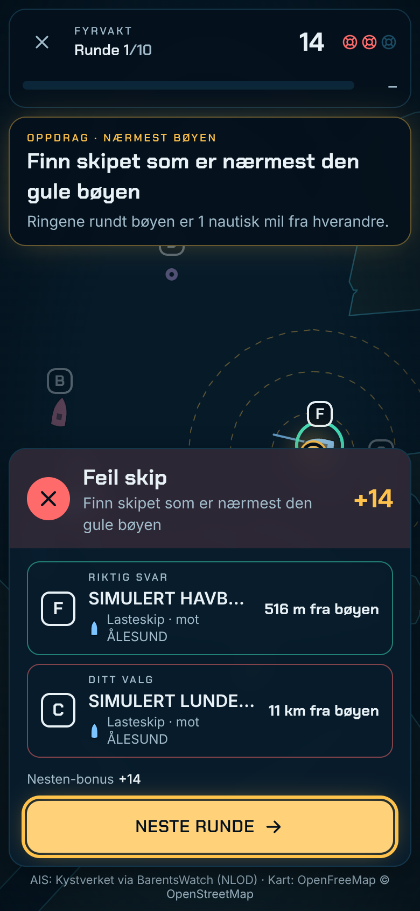
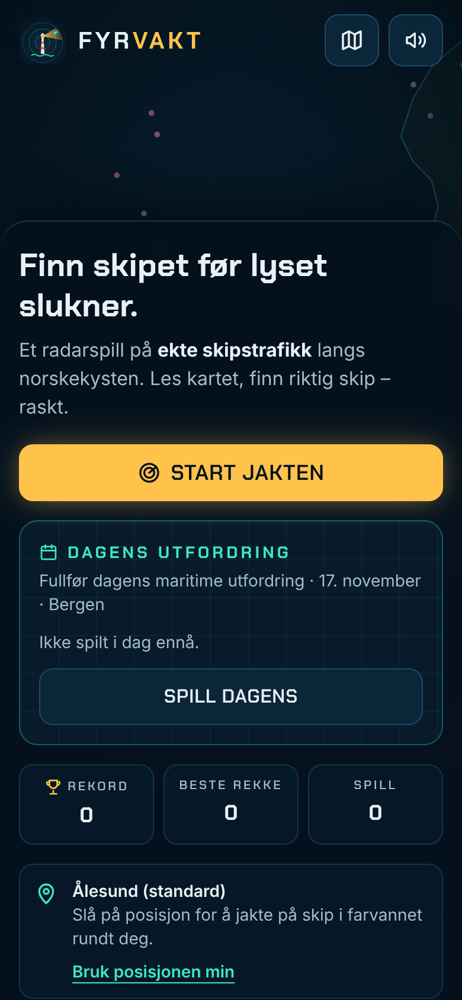
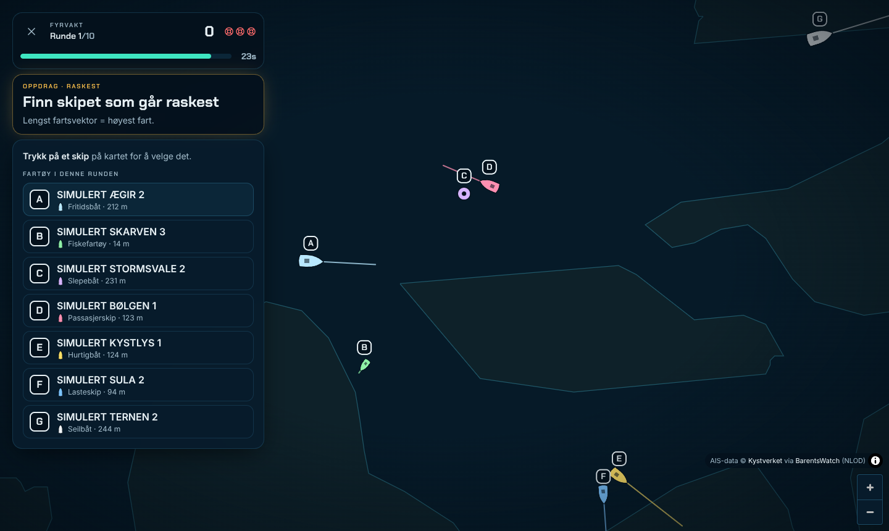

<p align="center">
  
</p>

<h1 align="center">Fyrvakt</h1>

<p align="center"><em>Finn skipet før lyset slukner.</em><br/>
A fast radar game on real ship traffic along the Norwegian coast – built as an installable PWA.</p>

<p align="center"><strong>▶ Play: <a href="https://olemartin93.github.io/kystjakten-spill/">olemartin93.github.io/kystjakten-spill</a></strong></p>

<p align="center">
  
  
  
</p>
<p align="center"></p>
<p align="center"><sub>Screenshots are from the development build with <strong>simulated vessels</strong> and a simplified coastline; the live site uses real AIS data and OpenFreeMap tiles.</sub></p>

---

## What is it?

You keep the lighthouse watch (_fyrvakt_). Every round gives you an objective – _“Find the fastest ship”_, _“Find the ship closest to the yellow buoy”_, _“Find the tanker”_ – and 25 seconds to tap the right vessel on a live map of real ships near you.

The name was chosen from a shortlist (Fyrvakt, Leia, Radarlei, Havøye, Peilejakt, Kursklar, Skipsspeideren): _Fyrvakt_ is short, unmistakably Norwegian, game-like, works as a domain name, and doesn't sound like an official Kystverket product.

## How the game works

|                     |                                                                                                                                                                                                                         |
| ------------------- | ----------------------------------------------------------------------------------------------------------------------------------------------------------------------------------------------------------------------- |
| **Rounds**          | 10 rounds (classic) or 5 (daily). Each round takes 15–30 seconds.                                                                                                                                                       |
| **Lives**           | 3 lifebuoys. A wrong answer or timeout costs one.                                                                                                                                                                       |
| **Score**           | 1 000 base + 25 per remaining second + up to 500 for precision. Near misses (e.g. the 2nd fastest ship) earn up to 300 consolation points.                                                                              |
| **Streak**          | 2 in a row ×1.2 · 3 ×1.5 · 4 ×2 · 5+ ×2.5                                                                                                                                                                               |
| **Challenges**      | fastest · slowest · closest to buoy · heading north/south/east/west · course nearest a bearing · ship type (cargo, tanker, fishing, passenger, high-speed, tug…) · cruise ship / big ferry · speed range · longest ship |
| **Daily challenge** | Same harbour and same challenge sequence for everyone, derived deterministically from the date (Europe/Oslo). Best daily score is stored locally.                                                                       |
| **Location**        | Uses your position if allowed; otherwise Ålesund. If it's quiet around you (inland), you're moved to the nearest busy harbour.                                                                                          |

**Reading the radar:** ship symbols point in the direction of travel (north up); the line ahead of a ship is its 6-minute speed vector (10 knots = 1 nautical mile = one range ring); symbol size follows ship length; round symbols are stationary. Each ship has a letter badge (A, B, C…).

**Accessibility:** every round can be played without the map: use the vessel list or press the letter keys (A–J), then confirm. Focus moves to the relevant action, results are announced through a live region, colour is never the only cue, `prefers-reduced-motion` is respected, and touch targets are ≥ 44 px.

## Data & architecture

```
BarentsWatch Live AIS API  (OAuth2 client credentials – secret stays in GitHub Actions)
        │  scripts/fetch-ais-snapshot.ts  (every ~15 min via scheduled workflow)
        ▼
data/ais.json  (compact, validated snapshot published with the site)
        │  src/services/ais/provider.ts + normalize.ts
        ▼
Vessel model  (src/types/vessel.ts)
        │  src/game/*  (pure, unit-tested engine: challenges, scoring, daily seed)
        ▼
React UI + MapLibre GL  (src/components, src/map)
```

**Why a snapshot instead of calling the API from the browser?** The BarentsWatch Live AIS API requires an OAuth2 _client secret_ (client-credentials flow, scope `ais`). A static site on GitHub Pages cannot keep a secret, so the browser never calls BarentsWatch. A GitHub Actions workflow fetches `GET https://live.ais.barentswatch.no/v1/latest/combined` with the secret stored as a repository secret, filters and compacts the data (Norwegian waters, positions < 60 min old, valid speed, no base stations/AtoN), and publishes it as `data/ais.json` next to the app. Between snapshots the app dead-reckons each ship forward from its last report (speed × time along its course, capped at 20 minutes), so ships keep moving on the map.

This is one request every ~15 minutes – far below any reasonable rate limit. The service worker caches the snapshot network-first for at most 3 hours, so the game can be played briefly offline but never on old data indefinitely.

### Project structure

```
src/
  components/   UI (start screen, HUD, pick panel, reveal card, game over, dialogs)
  game/         engine.ts, challenges.ts, scoring.ts, daily.ts, area.ts – no React, fully tested
  services/ais/ snapshot format, BarentsWatch transform, normalizer, provider, error mapping
  map/          MapLibre style, layers, canvas icons, GeoJSON builders, MapView component
  hooks/        geolocation, AIS loading/refresh, game controller, media queries
  persistence/  localStorage (high score, daily best, settings) – crash-proof
  utils/        geo math, seeded RNG, dates, formatting, sound effects
scripts/
  fetch-ais-snapshot.ts   deploy-time AIS fetch (Node ≥ 22.18, runs TypeScript natively)
  smoke-test.mjs          post-deploy browser test of the live site
  generate-icons.mjs      renders the SVG logo to PWA PNG icons
```

Adding a challenge type = one `ChallengeDefinition` (build + evaluate) in `src/game/challenges.ts`; the engine, UI and daily mode pick it up automatically.

## Development

```bash
npm install
npm run dev:mock   # dev server with a clearly labelled, simulated fleet (no network/API needed)
npm run dev        # dev server reading public/data/ais.json (create it with the snapshot script)
npm run lint       # ESLint (strict, type-aware) + Prettier
npm test           # Vitest – engine, scoring, daily determinism, AIS parsing, error handling…
npm run build      # type-check + production build into dist/
```

To use real data locally (needs a BarentsWatch client):

```bash
BARENTSWATCH_CLIENT_ID='you@example.com:fyrvakt' BARENTSWATCH_CLIENT_SECRET='…' \
  node scripts/fetch-ais-snapshot.ts public/data/ais.json
npm run dev
```

`public/data/ais.json` is git-ignored – live AIS data is never committed. The simulated fleet only exists in Vite's `mock` mode and is tree-shaken out of production builds.

## Deployment (GitHub Pages)

`feature branch → pull request (CI: lint, test, build) → merge to main → Deploy workflow → GitHub Pages`

- `.github/workflows/ci.yml` runs lint, tests and build on every PR/branch push.
- `.github/workflows/deploy.yml` builds with the correct base path (from `actions/configure-pages`), fetches the AIS snapshot, deploys, then runs `scripts/smoke-test.mjs` against the live URL (manifest, icons, service worker, SPA fallback, map tiles, a full game round).
- The same workflow runs every 15 minutes to refresh the AIS snapshot. Without credentials those scheduled runs are skipped quietly.

**One-time setup**

1. _Settings → Pages → Build and deployment → Source: **GitHub Actions**_ (the workflow also tries to enable this automatically).
2. Register at [barentswatch.no](https://www.barentswatch.no/), open _Min side → API-tilgang_, and create a client of type **AIS**.
3. Add two repository secrets (_Settings → Secrets and variables → Actions_): `BARENTSWATCH_CLIENT_ID` (e.g. `you@example.com:fyrvakt`) and `BARENTSWATCH_CLIENT_SECRET`.
4. Run the **Deploy to GitHub Pages** workflow once (_Actions → Run workflow_).

The site is served from `/kystjakten-spill/`; set `BASE_PATH=/` when building for a custom domain.

## Attribution & licences

- **AIS data:** open AIS data from **Kystverket** (the Norwegian Coastal Administration), delivered through the **BarentsWatch** Live AIS API under the [Norwegian Licence for Open Government Data (NLOD) 2.0](https://data.norge.no/nlod/en/2.0). Data originates via BarentsWatch, as their terms require. Only the open position/voyage data is used – not the commercially licensed `shipinfo` endpoints.
- **Basemap:** [OpenFreeMap](https://openfreemap.org) © [OpenMapTiles](https://www.openmaptiles.org/), data © [OpenStreetMap contributors](https://www.openstreetmap.org/copyright) (ODbL).
- **Nautical chart (optional layer):** © [Kartverket](https://www.kartverket.no/) (CC BY 4.0).
- **Map engine:** [MapLibre GL JS](https://maplibre.org/) (BSD-3-Clause). Fonts: Chakra Petch and Inter (SIL OFL).

**Fyrvakt is an unofficial hobby project. It is not affiliated with, endorsed by or connected to Kystverket, BarentsWatch or Kartverket. Not for navigation.**

The source code is released under the [MIT licence](LICENSE). The logo is original artwork made for this project.

## Known limitations

- Positions are a snapshot refreshed roughly every 15 minutes (GitHub may delay scheduled workflows), with dead reckoning in between – not true real-time. A true live feed would need a small server-side proxy holding the API secret (e.g. a serverless function); the provider interface in `src/services/ais/provider.ts` is ready for that.
- GitHub disables scheduled workflows after 60 days without repository activity – re-enable it under _Actions_ if the data stops updating.
- The daily challenge fixes the harbour and challenge sequence for everyone; the ships themselves are whatever is actually there when you play.
- AIS coverage depends on what ships transmit: some have no name, length or valid course, and those are filtered out of the relevant challenges.
- The Kartverket sea-chart layer uses Kartverket's public WMTS cache; if it is unavailable the toggle switches itself off.
